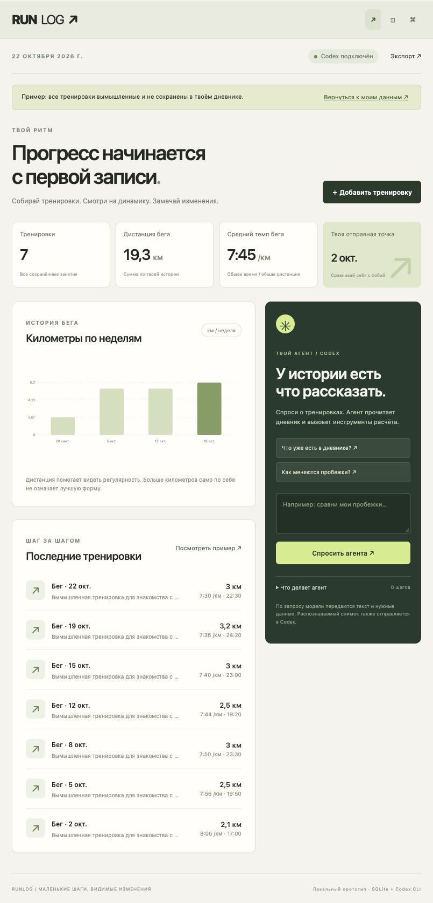

# RUNLOG

Личный дневник тренировок: шаги с iPhone через Apple Health, фото дорожки через Telegram, история и проверяемые отчёты.



## Запуск

Node.js 24+, установленный и авторизованный Codex CLI. Для синхронизации Apple Health — iPhone и Mac с одним iCloud Drive.

```sh
npm ci --ignore-scripts
cp .env.example .env
npm start
```

Открыть [127.0.0.1:8787](http://127.0.0.1:8787). Распознавание и агент используют существующую авторизацию Codex; ручной ввод, импорт и расчёты работают без модели.

## iPhone

1. Передать [RUNLOG Health Sync.shortcut](shortcuts/RUNLOG%20Health%20Sync.shortcut) на iPhone и добавить в «Команды».
2. Запустить вручную, разрешить чтение шагов и дистанции ходьбы и бега. Проверить действие сохранения: **iCloud Drive / Shortcuts / runlog-health.json**, замена существующего файла, без запроса места сохранения.
3. Создать личную автоматизацию: открытие Telegram → немедленно запустить RUNLOG Health Sync.
4. Оставить RUNLOG на Mac запущенным. Импорт проверяет один файл каждые 15 секунд. Первый результат сверить со «Здоровьем».

Команда подписана средствами Apple. Установка, разрешения и выполнение Health-действий требуют iPhone; подписание файла не подтверждает успешный импорт с конкретного телефона. При заблокированном телефоне выполнение может потребовать разблокировки. Когда Mac выключен, файл ждёт следующего запуска.

Экспорт охватывает последние 8 суток. Самый ранний неполный день не импортируется; сегодняшний обновляется. Повторный импорт заменяет дневной снимок, не прибавляет его ещё раз. Пустой экспорт не превращается в нулевую активность. Источники разных устройств не суммируются: выбирается один iPhone, при неоднозначности импорт просит указать `RUNLOG_HEALTH_SOURCE`.

## Telegram

Создать бота через [BotFather](https://t.me/BotFather), затем:

```sh
npm run setup:telegram
npm run bot
```

Настройка скрывает ввод токена и записывает его только в локальный `.env`. Доступ закрепляется за подтверждённым Telegram ID; группы и другие пользователи игнорируются. Бот работает, пока запущен процесс на Mac. Публичный сервер не нужен.

- Фото дорожки → распознавание → исправление → подтверждение сохранения.
- `/activity` — шаги за неделю; `/summary` — пробежки за 30 дней.
- `/history`, `/compare`, `/photos`, `/export`, `/cancel`.
- XML Apple Health и JSON с массивом `workouts` → проверка и подтверждение импорта.

## Как устроен агент

**Вход:** запрос, необязательное фото тренировки, текущая дата. **Память:** SQLite с записями и исходными показателями. Модель выбирает действие; приложение выполняет его и возвращает результат для следующего шага.

| Инструмент         | Результат                                       |
| ------------------ | ----------------------------------------------- |
| `list_workouts`    | История с идентификаторами записей              |
| `get_progress`     | Дистанция, взвешенный темп, недельные суммы     |
| `get_activity`     | Шаги и дни с доступными образцами Health        |
| `compare_workouts` | Две пробежки с разницей дистанций не больше 10% |
| `propose_workout`  | Черновик; запись только после подтверждения     |

**Выход:** отчёт с источниками или редактируемый черновик. Расчёты и окончательный текст числовых отчётов формирует код. Свободный ответ модели не заменяет проверенные цифры. Неверные даты, единицы, диапазоны и повторы отклоняются. Цикл ограничен четырьмя шагами. Повседневная дистанция не включается в пробежки; изменение темпа не трактуется как доказанное улучшение формы.

## Хранение и настройки

SQLite и изображения находятся в `data/` либо `RUNLOG_DATA_DIR`. `.env`, данные и авторизация исключены из Git. JSON-экспорт не включает изображения; для полной резервной копии нужно сохранить каталог данных при остановленных процессах.

| Переменная                             | Назначение                                                                           |
| -------------------------------------- | ------------------------------------------------------------------------------------ |
| `RUNLOG_SYNC_FILE`                     | Путь к файлу Health; по умолчанию iCloud Drive/Shortcuts/runlog-health.json на macOS |
| `RUNLOG_HEALTH_SOURCE`                 | Точное имя выбранного источника Health при неоднозначности                           |
| `RUNLOG_DATA_DIR`                      | Каталог личных данных                                                                |
| `SPORT_CODEX_BIN`, `SPORT_CODEX_MODEL` | Исполняемый файл и необязательная модель Codex                                       |
| `SPORT_TIMEZONE`, `SPORT_PORT`         | Часовой пояс и локальный порт                                                        |

Сервер доступен только через loopback. Изменения требуют токен запуска и допустимый Origin. Распознаваемое фото и нужные записи отправляются модели через Codex CLI; фото формы сохраняются отдельно без обработки моделью. CLI запускается с read-only sandbox и без пользовательской конфигурации; это не полная изоляция чтения файлов на уровне ОС.

## Проверки

```sh
npm test
```

Проверяются расчёты, источники и единицы Health, повторы и исправления снимков, частично записанный файл, права владельца бота, подтверждение черновиков, импорт XML, ограничения HTTP и защита числового отчёта от выдумок модели. Тестовые данные находятся только в `tests/`.

Исходник команды — `shortcuts/RUNLOG Health Sync.plist`. Генерация: `python3 scripts/build-shortcut.py`; после изменения файл необходимо повторно подписать через `shortcuts sign` на Mac.
